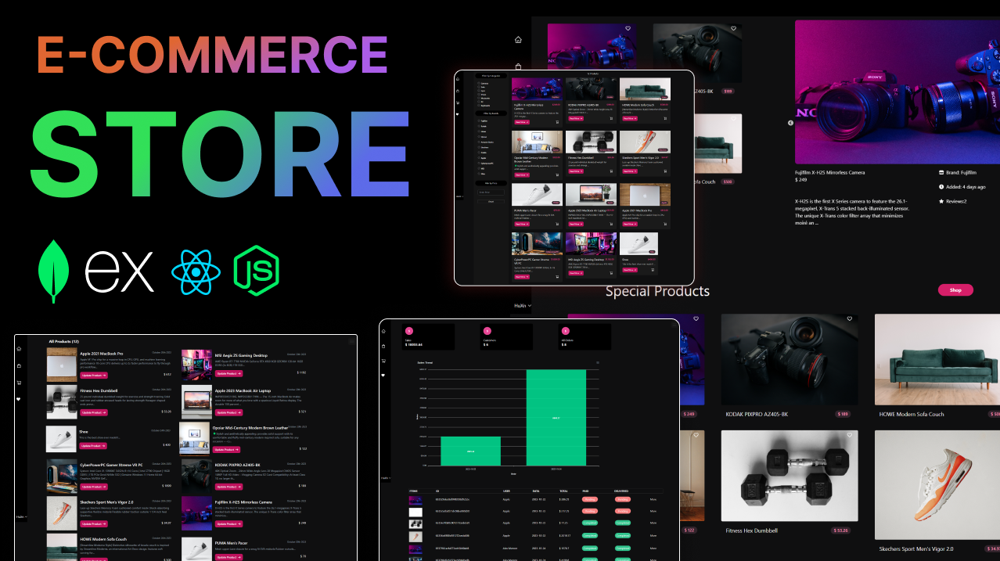

# 🛒 MERN Stack E-Commerce Platform

A modern, full-featured full-stack e-commerce web application built using the **MERN Stack** (MongoDB, Express.js, React, Node.js), powered by **Vite**, **Redux Toolkit**, **Tailwind CSS**, and integrated with **PayPal** for secure payments.



---

## 🌟 Key Features

### 👤 Customer Experience
- **User Authentication & Profiles**: Secure registration, login, and profile management with password hashing (`bcryptjs`) and JWT stored in HTTP-only cookies.
- **Product Exploration**:
  - Live product search by keywords.
  - Interactive product filter by category and price range.
  - Top-rated and new arrivals carousel powered by React Slick.
  - Detailed product view with high-resolution image previews, stock availability, and specs.
- **Ratings & Reviews**: Verified users can submit 1-to-5 star ratings and written reviews.
- **Shopping Cart & Wishlist**:
  - Persistent cart state with dynamic quantity adjustment and stock validation.
  - Favorites/Wishlist functionality to save desired items.
- **Checkout & Payments**:
  - Multi-step checkout pipeline: Shipping details $\rightarrow$ Order preview $\rightarrow$ Payment.
  - Seamless PayPal integration via `@paypal/react-paypal-js`.
  - Real-time order status tracking (Paid, Delivered).

### 🛠️ Admin Management Dashboard
- **Analytics Dashboard**: Interactive business intelligence charts (sales over time, order volumes) powered by **ApexCharts**.
- **Product Management**: Full CRUD operations for products, including image uploads via Multer.
- **Category Management**: Create, update, and manage taxonomy and product categories.
- **Order Management**: Monitor customer orders, track payments, and update delivery fulfillment status.
- **User Administration**: View registered users, assign or revoke administrative rights, and manage accounts.

---

## 🛠️ Technology Stack

### Frontend
- **Framework / Runtime**: [React 18](https://react.dev/) + [Vite](https://vitejs.dev/)
- **State Management**: [Redux Toolkit](https://redux-toolkit.js.org/) & [RTK Query](https://redux-toolkit.js.org/rtk-query/overview) (API caching & state)
- **Routing**: [React Router v6](https://reactrouter.com/)
- **Styling**: [Tailwind CSS](https://tailwindcss.com/) & [Flowbite](https://flowbite.com/)
- **UI Components & Icons**: [React Icons](https://react-icons.github.io/react-icons/), [React Slick](https://react-slick.neostack.com/)
- **Data Visualization**: [ApexCharts](https://apexcharts.com/) & [React-ApexCharts](https://github.com/apexcharts/react-apexcharts)
- **Notifications**: [React Toastify](https://fkhadra.github.io/react-toastify/)
- **Payments**: [@paypal/react-paypal-js](https://github.com/paypal/react-paypal-js)

### Backend
- **Runtime & Framework**: [Node.js](https://nodejs.org/) & [Express.js](https://expressjs.com/) (ES Modules)
- **Database**: [MongoDB](https://www.mongodb.com/) with [Mongoose ODM](https://mongoosejs.com/)
- **Authentication**: [JSON Web Tokens (JWT)](https://jwt.io/) & [Cookie-Parser](https://www.npmjs.com/package/cookie-parser)
- **Password Encryption**: [bcryptjs](https://www.npmjs.com/package/bcryptjs)
- **File Uploads**: [Multer](https://github.com/expressjs/multer) & [Express-Formidable](https://www.npmjs.com/package/express-formidable)
- **Dev Tooling**: [Nodemon](https://nodemon.io/) & [Concurrently](https://www.npmjs.com/package/concurrently)

---

## 📁 Project Architecture

```text
├── backend/
│   ├── config/             # Database connection (MongoDB)
│   ├── controllers/        # Request controllers (User, Product, Category, Order)
│   ├── middlewares/        # Auth, Admin verification, & ID validation middlewares
│   ├── models/             # Mongoose schemas (User, Product, Category, Order)
│   ├── routes/             # REST API routes
│   │   ├── categoryRoutes.js
│   │   ├── orderRoutes.js
│   │   ├── productRoutes.js
│   │   ├── uploadRoutes.js
│   │   └── userRoutes.js
│   ├── utils/              # Helper utilities (Token generation)
│   └── index.js            # Express application entry point
├── frontend/
│   ├── public/             # Static public assets
│   ├── src/
│   │   ├── components/     # Reusable components (Header, Navigation, Modal, etc.)
│   │   ├── pages/          # App pages
│   │   │   ├── Admin/      # Admin dashboard, order list, product & category management
│   │   │   ├── Auth/       # Login and Register pages
│   │   │   ├── Orders/     # Shipping, PlaceOrder, Order details
│   │   │   ├── Products/   # Product details, Favorites, Ratings
│   │   │   ├── User/       # User profile management
│   │   │   ├── Cart.jsx    # Shopping Cart
│   │   │   ├── Home.jsx    # Home landing page
│   │   │   └── Shop.jsx    # Shop catalog with filters
│   │   ├── redux/          # Redux store, slices, & RTK Query API endpoints
│   │   ├── App.jsx         # App shell & layout
│   │   └── main.jsx        # App routes and providers initialization
│   ├── index.html
│   ├── package.json
│   ├── tailwind.config.js
│   └── vite.config.js
├── example-env.env         # Environment variable template
├── package.json            # Root scripts & dependencies
└── README.md
```

---

## 📡 REST API Reference

### 🔐 Authentication & Users (`/api/users`)
| Method | Endpoint | Access | Description |
|---|---|---|---|
| `POST` | `/api/users` | Public | Register new user |
| `POST` | `/api/users/auth` | Public | Authenticate user & get cookie |
| `POST` | `/api/users/logout` | Public | Clear auth cookie |
| `GET` | `/api/users/profile` | Private | Get current user profile |
| `PUT` | `/api/users/profile` | Private | Update current user profile |
| `GET` | `/api/users` | Admin | Get list of all users |
| `GET` | `/api/users/:id` | Admin | Get user by ID |
| `PUT` | `/api/users/:id` | Admin | Update user details & admin status |
| `DELETE` | `/api/users/:id` | Admin | Delete user |

### 🛍️ Products (`/api/products`)
| Method | Endpoint | Access | Description |
|---|---|---|---|
| `GET` | `/api/products` | Public | Get paginated products / search |
| `GET` | `/api/products/allproducts` | Public | Fetch all products list |
| `GET` | `/api/products/top` | Public | Fetch top-rated products |
| `GET` | `/api/products/new` | Public | Fetch newly added products |
| `POST` | `/api/products/filtered-products` | Public | Filter products by category and price |
| `GET` | `/api/products/:id` | Public | Get single product details |
| `POST` | `/api/products` | Admin | Create product |
| `PUT` | `/api/products/:id` | Admin | Update product details |
| `DELETE` | `/api/products/:id` | Admin | Remove product |
| `POST` | `/api/products/:id/reviews` | Private | Add review and rating to a product |

### 🏷️ Categories (`/api/category`)
| Method | Endpoint | Access | Description |
|---|---|---|---|
| `GET` | `/api/category/categories` | Public | List all categories |
| `GET` | `/api/category/:id` | Public | Fetch single category by ID |
| `POST` | `/api/category` | Admin | Create category |
| `PUT` | `/api/category/:categoryId` | Admin | Update category name |
| `DELETE` | `/api/category/:categoryId` | Admin | Delete category |

### 📦 Orders (`/api/orders`)
| Method | Endpoint | Access | Description |
|---|---|---|---|
| `POST` | `/api/orders` | Private | Create new order |
| `GET` | `/api/orders/mine` | Private | Get logged-in user order history |
| `GET` | `/api/orders/:id` | Private | Get order by ID |
| `PUT` | `/api/orders/:id/pay` | Private | Update order status to paid |
| `GET` | `/api/orders` | Admin | Get all platform orders |
| `PUT` | `/api/orders/:id/deliver` | Admin | Mark order as delivered |
| `GET` | `/api/orders/total-orders` | Admin | Count total order volume |
| `GET` | `/api/orders/total-sales` | Admin | Compute aggregate sales revenue |
| `GET` | `/api/orders/total-sales-by-date` | Admin | Sales metrics grouped by date |

### 🖼️ Upload & Config
| Method | Endpoint | Access | Description |
|---|---|---|---|
| `POST` | `/api/upload` | Public / Admin | Upload single product image |
| `GET` | `/api/config/paypal` | Public | Retrieve PayPal Client ID |

---

## ⚙️ Environment Variables

Create a `.env` file in the root directory based on `example-env.env`:

```env
PORT=5000
MONGO_URI=mongodb://127.0.0.1:27017/huxnStore
NODE_ENV=development
JWT_SECRET=your_super_secret_jwt_key
PAYPAL_CLIENT_ID=your_paypal_client_id
```

---

## 🚀 Getting Started

### Prerequisites
- [Node.js](https://nodejs.org/) (v16 or higher)
- [MongoDB](https://www.mongodb.com/) (Local instance or MongoDB Atlas URI)
- [Git](https://git-scm.com/)

### Installation Steps

1. **Clone the repository:**
   ```bash
   git clone https://github.com/Sandeep-78/E-commerce-Store.git
   cd E-commerce-Store
   ```

2. **Install Backend Dependencies:**
   ```bash
   npm install
   ```

3. **Install Frontend Dependencies:**
   ```bash
   cd frontend
   npm install
   cd ..
   ```

4. **Configure Environment Variables:**
   ```bash
   cp example-env.env .env
   # Edit .env and supply your MongoDB URI, JWT Secret, and PayPal Client ID
   ```

5. **Run the Application in Development Mode:**
   ```bash
   npm run dev
   ```
   *This starts both the backend API server (`http://localhost:5000`) and the Vite frontend dev server concurrently.*

---

## 📜 Available Scripts

In the root directory, you can run:

- `npm run dev`: Runs frontend and backend concurrently in development mode.
- `npm run backend`: Runs only the backend server using `nodemon`.
- `npm run frontend`: Starts the Vite development server for the frontend.

Inside `frontend/`:
- `npm run dev`: Starts the Vite dev server at `http://localhost:5173`.
- `npm run build`: Builds the production bundle.
- `npm run preview`: Previews the production build locally.

---

## 👤 Author

- **GitHub**: [@Sandeep-78](https://github.com/Sandeep-78)
- **Email**: [sandyboy7878@gmail.com](mailto:sandyboy7878@gmail.com)

---

## 📄 License

This project is licensed under the **ISC License**.
